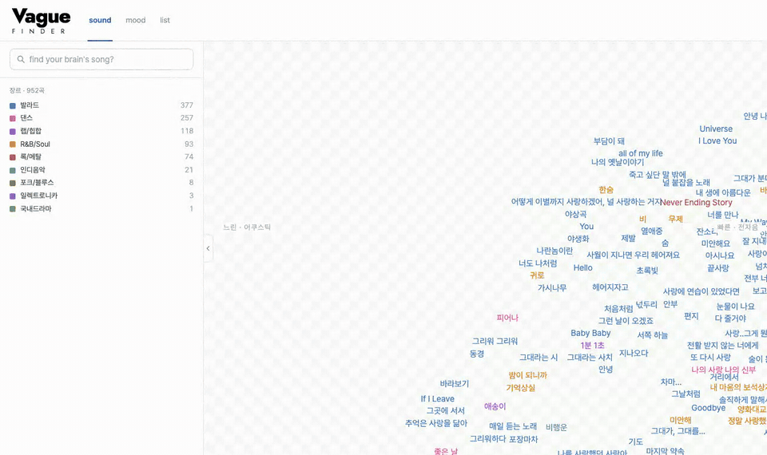
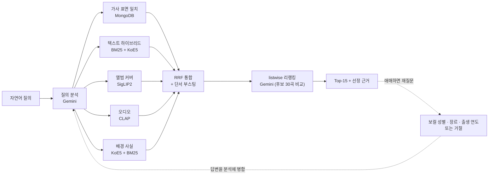

# Vague-Finder

**제목도 가수도 모를 때, 기억의 조각만으로 노래를 찾는 멀티모달 검색 엔진**


> "2000년대 후반에 싸이월드 배경음악으로 엄청 유행했던 곡인데, 여자애들 여러 명이 부르는 빠른 댄스곡이었어.
> 제목이 알파벳 세 글자였던 것 같은데"

키워드 검색은 제목이나 가수를 알아야 하고, 음악 인식은 소리를 들려줘야 한다. Vague-Finder는 그 사이를
메운다. 분위기, 상황, 앨범 커버의 인상, 소리의 느낌, 어렴풋한 가사 한 구절처럼 **모호하고 불완전한 회상
단서**를 자연어로 받아 후보 곡을 찾는다. 한국 대중음악 5,143곡(2026-10-11 확장)을 대상으로 한 연구용 프로토타입이다.

<p align="center">
  
</p>
<p align="center"><sub>
  소리 지도 → 정서 지도 → 분위기로 검색 → 결과가 지도 위에 표시되고 1위 곡의 선정 근거를 펼친다.
  앨범 커버는 저작권 때문에 흐리게 처리했다.
</sub></p>

## 주요 기능

- **질의 분석** — Gemini가 질의를 가사 조각, 분위기·상황 태그, 커버 이미지 인상, 소리 인상, 시대·보컬 성별 같은
  단서로 나누고 모달리티별 가중치를 정한다
- **멀티모달 병렬 검색** — 가사 표면 일치, 텍스트 하이브리드(BM25 + KoE5), 앨범 커버(SigLIP2), 오디오(CLAP, 음원 앞 120초),
  배경 사실(나무위키에서 뽑은 작품·사건 사실, 639곡) 경로를 동시에 돌려 RRF로 합친다
- **리랭킹** — Gemini가 최대 30곡의 후보를 비교해 순서를 다시 정한다(listwise). 가사 보호 후보는 묶음별로 재정렬할 수 있어 질의당 호출 수는 달라진다. 한국어 Cross-Encoder는 선택 백엔드로 남아 있다
- **재질문** — "이 중에는 없어요"를 누르면 현재 후보로 보컬 성별·장르 질문을 계산한다. 답하면 거절한 곡을 빼고 다시 찾는다. "중학교 때 듣던"처럼 시기가 나이에 걸린 질의는 출생 연도를 먼저 받아 결과만 갱신한다. 정답을 찾았다면 추가 질문은 계산하지 않는다
- **선정 근거** — 어떤 검색 경로가 순위를 만들었는지 보여 주고, 가사가 근거일 때는 원문 구절을 인용한다
- **노래 맵** — 5,143곡을 소리(CLAP)와 정서(KoE5) 두 기준의 2D 지도로 펼치고, 검색 결과를 지도 위에 표시한다.
  재생은 YouTube 임베드로 한다

## 검색 구조



| 경로 | 모델 · 저장소 |
| --- | --- |
| 질의 분석 | `gemini-3.1-flash-lite` |
| 텍스트 (dense / sparse) | [`nlpai-lab/KoE5`](https://huggingface.co/nlpai-lab/KoE5) / BM25 (Kiwi 형태소 분석) |
| 이미지 | [`google/siglip2-base-patch16-224`](https://huggingface.co/google/siglip2-base-patch16-224) |
| 오디오 | [`laion/clap-htsat-fused`](https://huggingface.co/laion/clap-htsat-fused) |
| 배경 사실 (Context) | KoE5 사실 단위 dense(5,054개) + 곡 단위 BM25(639곡) |
| 리랭킹 | `gemini-3.1-flash-lite` listwise (1패스, Google Search 끔) · 선택: [`dragonkue/bge-reranker-v2-m3-ko`](https://huggingface.co/dragonkue/bge-reranker-v2-m3-ko) Cross-Encoder |
| 벡터 DB | Qdrant (로컬 파일 모드 기본, 서버 모드 지원) |
| 가사 정확 일치 | MongoDB (없으면 이 경로만 비고 나머지는 동작) |

## 성능

### 최신 측정 — 5,143곡 · dev 176 · Vertex AI (2026-10-18 ~ 10-20)

평가 질의는 dev 176건(v06 57 + v09 59 + v10 60)이고, 원래 타깃만 정답으로 세는 엄격 지표다. 리랭커는 Vertex AI의
`gemini-3.1-flash-lite` listwise다. 두 실험(v73 · v75)은 각각 구성 둘을 A1 → B1 → B2 → A2 순서로 두 번씩 쟀고,
여덟 실행 모두 리랭킹 실패 0이다.

| 구성 | 실험 · 실행 | 후보 회수@30 | Hit@1 | Hit@5 | Hit@10 | MRR@10 |
| --- | --- | --- | --- | --- | --- | --- |
| 작품명 해석 OFF · 소리 ON (코드 기본 스위치와 같다) | v73 A1 / A2 | 122 | 81 / 80 | 107 | 117 (66.5%) | 0.531 / 0.529 |
| **작품명 해석 ON · 소리 ON (개발 비교 기준)** | v73 B1 / B2 | 125 | 83 / 84 | 111 | **121 (68.8%)** | 0.547 / 0.550 |
| 같은 구성 재측정 | v75 A1 / A2 | 125 | 83 | 111 | 121 (68.8%) | 0.547 |
| 작품명 해석 ON · 소리 경로 생략 (보류) | v75 B1 / B2 | 130 | 78 | 114 | 123 (69.9%) | 0.540 |

- 실험마다 A/B의 뜻이 다르다. **v73의 B와 v75의 A가 같은 구성**(작품명 해석 ON · 소리 ON)이다.
- 효과는 같은 실험 안에서만 비교한다. 작품명 해석은 v73 안에서 Hit@10 117 → 121(+4 / −0, 두 반복 같음)이다.
  소리 경로 생략은 v75 안에서 121 → 123(+3 / −1)이지만 Hit@1이 83 → 78로 줄어 채택하지 않았다. 통계적 유의성은 주장하지 않는다
- 개발 비교 기준에서 Hit@10 실패 55건 중 51건은 정답이 후보 30곡에 들지 못했고, 후보에 든 정답은 121/125가 10위 안에 든다.
  후보 30을 고정한 지금 구조에서는 후보 회수(125/176, 71.0%)가 Hit@10의 상한이다
- 측정 조건: 평가기 `evaluate_search_accuracy`(서버 모드 Qdrant, 예열 뒤) · 고정 질의 분석 캐시(v49) · 고정 작품명 해석 캐시(v71 반복 1) ·
  리랭킹 호출 60초 / 질의 120초(평가 전용, 서비스 기본은 20초 / 30초) · Context 가중 0.5 · 속성 보조 · 피드백 꺼짐.
  측정 코드는 v73 `d8c3878`(재시도 정정 수정 사본, 뒤에 #87로 병합) · v75 `81965f6`(현재 main과 `src`·`tests` 같음)
- 근거: [`results_v73_work_name_full_ab`](experiments/reranking/results_v73_work_name_full_ab/RUN_INFO.md)(`attempt3/analysis/`) ·
  [`results_v75_work_audio_live_ab`](experiments/reranking/results_v75_work_audio_live_ab/RUN_INFO.md)(`analysis/`).
  후보 밖 실패의 원인 분류는 [`results_v74_candidate_recall_work_audio`](experiments/reranking/results_v74_candidate_recall_work_audio/RUN_INFO.md)

**검증하지 않은 범위**

- dev 176은 설계·진단에 반복해서 쓴 세트다. 개발 비교 기준(작품명 해석 ON)을 독립 test로 잰 수치는 없다.
  기존 test(v06 25 · v09 38 · v10 42)는 모두 이미 열었다. 새 독립 평가 자료(v11)는 수집 준비만 됐고 수집은 0건이다
- 위 수치는 평가기의 리랭킹 포함 품질이다. 실제 HTTP 요청 전체 경로, 실시간 질의 분석·작품명 해석, 서비스 기본 시간 제한(20초 / 30초),
  기동 직후 첫 요청, 요청 전체 응답 시간은 이 구성으로 재지 않았다. 평가기의 리랭킹 호출 지연(v73 실행별 중앙값 4.48~4.92초, v75 4.69~4.91초)은 HTTP 전체 응답 시간이 아니다
- 재질문(2턴)은 Vertex AI 전환 뒤 전체 재측정이 없다

### 기능 적용 상태

아래 "코드 기본값"은 환경 변수가 없을 때의 값이다. 실행 중인 서버는 `.env`와 환경 변수를 따르므로 `/health`와 기동 로그로 확인한다.

| 기능 | 구현 | 코드 기본값 | 평가 |
| --- | --- | --- | --- |
| 배경 사실 Context | 있음 | 켬 (`CONTEXT_WEIGHT` 기본 0.5) | 위 측정의 모든 구성에 0.5로 포함 |
| 소리 경로 (CLAP) | 있음 | 켬 (`AUDIO_FUSION_SCALE` 기본 1) | 생략 구성과 A/B(v75) → 보류 |
| 작품명 해석 (간접 지칭 → 작품명 → 보조 후보) | 있음 | 꺼짐 (`WORK_NAME_RESOLUTION_ENABLED`) | dev 176 A/B(v73, 고정 해석 캐시). 실시간 해석·서비스 시간 제한에서의 품질은 미측정 |
| 속성 조건 보조 (시기·성별·장르 필터) | 있음 | 꺼짐 (`ATTR_FILTER_WEIGHT` 기본 0) | v10 test 42에서 꺼진 구성과 22/42 동률([`results_v55_attr_final_validation`](experiments/reranking/results_v55_attr_final_validation/RUN_INFO.md)) |
| 정답 피드백 수집 · 승인 사례 색인 · 후보 보충 | 있음 | 셋 다 꺼짐 (`FEEDBACK_COLLECTION_ENABLED` · `FEEDBACK_INDEX_WORKER_ENABLED` · `FEEDBACK_RETRIEVAL_ENABLED`) | 비교 도구와 합성 자료 시험만. 실제 자료 품질 측정은 없다([`docs/feedback.md`](docs/feedback.md)) |
| 앨범 소개 원문 보조 (v76 낱말 · v78 의미) | main에 없음 | — | 후보 단계 오프라인 비교만, 실제 리랭킹 미측정 → 보류. 결과와 재현 패치만 보존 |

### 과거 측정 — 3,010곡 · AI Studio (2026-10-09 전후)

코퍼스를 5,143곡으로 바꾸기 전, Gemini를 AI Studio 키로 부르던 시기의 측정이다. 코퍼스·호출 경로·질의 세트가 위와 달라
**위 표와 개선 전후로 비교하지 않는다.** 표의 "당시 기본"은 그때의 기본 설정이다.

평가 질의는 두 세트다. **v06**(팀이 직접 쓴 회상형 질의, dev 57 · test 25)과 **v09**(2026-10 추가, Claude 초안 + 팀장 검토, dev 59 · test 38).
원래 타깃만 정답으로 세는 엄격 지표다. 리랭커 두 백엔드를 같은 질의·같은 후보로 잰 결과다.
Gemini listwise는 두 줄이다. 전환 근거가 된 측정(v32~v34)은 드라마·OST 질의에 웹 검색 교차검증을 켠 설정이었고, 당시 기본값은 그 검증을 끈 설정(v35)이다.

| 세트 | 리랭커 | Hit@1 | Hit@5 | Hit@10 | MRR@10 |
| --- | --- | --- | --- | --- | --- |
| v06 dev (57) | Cross-Encoder | 0.386 | 0.561 | 0.649 | 0.451 |
| v06 dev (57) | Gemini listwise, 교차검증 켬 (v32) | 0.491 | 0.702 | 0.737 | 0.560 |
| v06 dev (57) | Gemini listwise, 당시 기본 (v35) | 0.474 | 0.702 | 0.754 | 0.556 |
| v09 dev (59) | Cross-Encoder | 0.288 | 0.525 | 0.610 | 0.385 |
| v09 dev (59) | Gemini listwise, 교차검증 켬 (v33) | 0.525 | 0.678 | 0.712 | 0.588 |
| v09 dev (59) | Gemini listwise, 당시 기본 (v35) | 0.525 | 0.678 | 0.695 | 0.589 |
| v09 test (38, 봉인·1회) | Cross-Encoder | 0.368 | 0.553 | 0.632 | 0.460 |
| v09 test (38, 봉인·1회) | Gemini listwise, 교차검증 켬 (v34) | 0.500 | 0.737 | 0.789 | 0.609 |

- 교차검증 켠 설정 기준 세 세트 합산 154건에서 Top-10 진입 97 → 114, Top-10 이탈 0건. 튜닝에 쓰지 않은 봉인 test에서도 dev와 같은 크기다
- 교차검증을 끈 당시 기본은 dev 116건에서 Hit@10 84 → 84(v06 +1, v09 −1)로 같았다. 봉인 test는 한 번만 열기로 해 그 설정으로 다시 재지 않았다.
  검증은 구조 규칙(`gemini_rare_fact_rescue`)으로만 순서에 반영되는데 v34에서 발동 0회라, 끈 설정이어도 같은 결과가 나왔을 측정이다
- 요청 전체 처리 시간(dev 57건, 예열 뒤, 당시 코퍼스·호출 경로): Cross-Encoder 중앙값 **4.2초** · p95 5.3초, Gemini listwise 중앙값 **7.0초** · p95 8.6초.
  질의당 Gemini 호출은 2회(질의 분석 1 · 리랭킹 1)다. 교차검증을 켜면 외부 맥락 질의만 리랭킹이 약 11초 늘어 p95가 18.8초였다. 5,143곡 · Vertex AI에서 같은 방식으로 다시 잰 기록은 없다(`experiments/latency/`)
- 허용 정답(팀이 검토해 더한 유사 정답)까지 세는 확장 지표는 v06에만 있다: Cross-Encoder 기준 dev Hit@10 0.789 · test 0.680
- 측정 방법·코드 판·실행 조건과 근거(각 `RUN_INFO.md`): [`results_v35_rare_verify_off`](experiments/reranking/results_v35_rare_verify_off/RUN_INFO.md)(당시 기본) · [`results_v32_gemini_listwise`](experiments/reranking/results_v32_gemini_listwise/RUN_INFO.md) ·
  [`results_v33_v09_dev`](experiments/reranking/results_v33_v09_dev/RUN_INFO.md) · [`results_v34_v09_test`](experiments/reranking/results_v34_v09_test/RUN_INFO.md) ·
  Cross-Encoder 기준선 [`results_v22_corpus3010`](experiments/reranking/results_v22_corpus3010/RUN_INFO.md) · 처리 시간 [`run_v04_hybrid_payload`](experiments/latency/run_v04_hybrid_payload/RUN_INFO.md)(CE) · [`run_v06_rare_verify_off`](experiments/latency/run_v06_rare_verify_off/RUN_INFO.md)(listwise)

## 기술 스택

| 영역 | 기술 |
| --- | --- |
| Backend |    |
| AI · ML |    |
| Search · Storage |   |
| Data Pipeline |    |
| Frontend |    |
| Infra · Test |   |

## 데이터와 저작권

**이 저장소에는 수집한 곡 데이터가 없다.** 가사·앨범 소개문·댓글 원문과 음원·앨범 커버, 그리고 거기서 뽑은
임베딩 벡터와 곡 목록은 저작물이거나 그 파생물이라 공개하지 않는다. 화면도 음원과 이미지를 직접 호스팅하지 않는다.
재생은 YouTube 임베드에 맡기고 커버는 원본 CDN을 참조한다. 학술 연구 목적의 프로토타입이다.

수집 데이터를 무엇에 어디까지 쓰는지(저작권·초상권), 시연 기준, 예상 질문 답변은
[`docs/data_policy.md`](docs/data_policy.md)에 정리했다.

팀원은 아래 데이터를 팀 드라이브에서 받는다.

| 무엇 | 위치 | 받는 법 |
| --- | --- | --- |
| 곡 폴더 (`meta.json` · `audio.m4a` · `cover.jpg`) | `VAGUEFINDER_DATA_DIR` | 팀 드라이브 (`.env.example` 참고) |
| 곡 레코드 · 임베딩 벡터 | `data/all_songs.jsonl` · `artifacts/embeddings/` | [`docs/vector_backend.md`](docs/vector_backend.md) 절차 |
| 배경 사실(Context) 자료 · dense/sparse 산출물 | `artifacts/context/` · Context 임베딩/BM25 산출물 | [`docs/namuwiki_context_vector_db.md`](docs/namuwiki_context_vector_db.md)의 입력 준비·적재 절차 |
| 지도 화면 데이터 | `src/frontend/static/map_data.json` | 팀 드라이브 `vague-finder/map_data.json`, 또는 `venv/bin/python -m src.pipelines.build_map` (곡 레코드와 임베딩 필요) |

## 시작하기

**필요한 것**: Python 3.11 이상, ffmpeg (오디오 디코딩), Vertex AI를 쓸 수 있는 GCP 프로젝트와 인증(서비스 계정 키 파일 또는 ADC 로그인, Gemini), 위의 데이터.
Node.js는 수집 파이프라인(yt-dlp)을 돌릴 때만 필요하다.

```bash
# 1. 설치
python3 -m venv venv
venv/bin/pip install -r requirements.txt

# 2. 환경 변수 — Gemini는 Vertex AI 전용: GCP_PROJECT_ID(크레딧이 연결된 프로젝트) + 인증
#    AI Studio 키(GEMINI_API_KEY)는 쓰지 않는다. 서버는 기동에서 설정·인증·모델을 확인한다 (.env.example 3)
cp .env.example .env
#    인증 ① 팀 공용 서비스 계정 키: 팀 드라이브의 vertex-sa.json을 secrets/ 에 두면 끝 (.env 기본값이 가리킨다. Docker도 같다)
#    인증 ② 개인 ADC: 프로젝트에 초대된 계정으로 한 번 실행하고 .env의 GOOGLE_APPLICATION_CREDENTIALS 줄을 지운다
gcloud auth application-default login

# 3. 벡터 DB 적재 (data/all_songs.jsonl과 artifacts/embeddings/가 있어야 한다)
venv/bin/python -m src.vector_db.cli.qdrant_load --recreate

# 3-1. Context 적재 — 위 곡 적재 명령에는 포함되지 않는다
# Context 자료와 dense/sparse 산출물을 먼저 준비하고, 서버가 꺼진 상태에서 실행한다
venv/bin/python -m src.vector_db.cli.qdrant_load_context --dry-run
venv/bin/python -m src.vector_db.cli.qdrant_load_context

# 4. 서버 실행
venv/bin/uvicorn src.backend.main:app --reload
```

Context는 기본 가중치가 0.5여서, 필요한 별칭·manifest·산출물이 미발행이거나 불일치하면 서버 기동이 실패한다.
입력 준비와 적재 옵션은 [`Context 적재 안내`](docs/namuwiki_context_vector_db.md)를 따른다. Context 자료 없이 실행하려면
3-1단계를 건너뛰고 `.env`에 `CONTEXT_WEIGHT=0`을 명시한다. 이 경우 배경 사실 경로가 꺼지므로 위 성능표의 평가 구성과 다르다.

| 주소 | 내용 |
| --- | --- |
| `http://127.0.0.1:8000/map` | 노래 맵과 검색 화면 |
| `http://127.0.0.1:8000/docs` | API 문서 |
| `http://127.0.0.1:8000/health` | 서버 상태와 모델 예열 진행 |

```bash
curl -X POST http://127.0.0.1:8000/api/v1/search \
  -H "Content-Type: application/json" \
  -d '{"query": "비 오는 날 혼자 듣기 좋은 잔잔한 발라드", "top_k": 10, "explain": true}'
```

로컬 Qdrant는 저장 폴더를 한 프로세스만 열 수 있다. 서버가 떠 있는 동안에는 적재 명령이 실패한다.

## 개발

```bash
# 테스트 — 화면(map.js) 상태 전이 시험(tests/frontend/*.test.cjs)도 함께 돈다. Node.js가 없으면 실패한다
venv/bin/python -m pytest tests/ -q

# 검색 정확도 재측정 — 질의 분석을 캐시로 고정해야 같은 측정이 같은 숫자를 낸다
# 1단계는 캐시가 이미 있으면 빠진 질의만 채운다. 분석기 코드·호출 경로가 바뀐 캐시는 덮어쓰지 않고 멈춘다 —
# 새 --output으로 만들거나 --reuse-despite-drift / --force를 명시한다 (옛 AI Studio 캐시는 --force로도 안 된다, --help 참고)
venv/bin/python -m src.retrieval.build_analysis_cache --input experiments/reranking/eval_queries_v06.csv \
  --split dev --output experiments/reranking/analysis_cache_v06_dev.json
venv/bin/python -m src.retrieval.evaluate_search_accuracy --input experiments/reranking/eval_queries_v06.csv \
  --split dev --analysis-cache experiments/reranking/analysis_cache_v06_dev.json \
  --output-dir experiments/reranking/results_vNN
```

| 폴더 | 내용 |
| --- | --- |
| `src/backend/` | FastAPI 서버, 요청·응답 스키마 |
| `src/retrieval/` | 질의 분석, 멀티모달 검색 라우터, 리랭킹, 재질문, 선정 근거 기록, 평가 스크립트 |
| `src/embedding/` | KoE5 · BM25 · SigLIP2 · CLAP 임베딩 |
| `src/vector_db/` | Qdrant 적재와 조회 |
| `src/crawler/` | 곡 메타데이터·가사·반응 수집과 LLM 정제 |
| `src/pipelines/` | 노래 맵 좌표 생성 (UMAP) |
| `src/frontend/static/` | 노래 맵과 검색 화면 |
| `experiments/` | 평가 질의 세트, 측정 결과와 실험 기록(`RUN_INFO.md`) |
| `docs/` | 데이터 스키마, 벡터 DB 절차, 협업 규칙 |

- 데이터 스키마: [`docs/data_schemas/music_metadata_schema.md`](docs/data_schemas/music_metadata_schema.md)
- 벡터 DB: [`docs/vector_backend.md`](docs/vector_backend.md)
- 브랜치 · PR 규칙: [`docs/git_convention.md`](docs/git_convention.md)

## 팀 — 애매하지않다

| 이름 | GitHub | 역할 | 담당 |
| --- | --- | --- | --- |
| **황찬혁** (팀장) | [@kuyhxl](https://github.com/kuyhxl) | PM · Full-stack | 일정 조율, 백엔드·프론트엔드 통합, API 연동 |
| **최정현** | [@2020202022](https://github.com/2020202022) | AI · Retrieval | 임베딩 모델 비교, 하이브리드 검색과 리랭킹, 검색 품질 평가 |
| **이연우** | [@yeonwoo0909](https://github.com/yeonwoo0909) | Data Engineer | 크롤링, 데이터 정제, 곡 단위 레코드 설계, DB 적재 |
